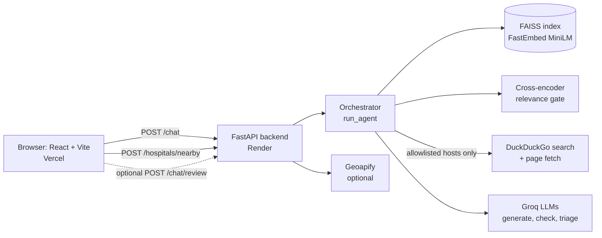

# SwasthyaSaathi

SwasthyaSaathi is a **public-health information chatbot** for the general public in India. It answers health questions in a chat interface using (1) a local, citation-ready knowledge base built from WHO, MoHFW, ICMR and related public-health documents, and (2) when the local material is weak or incomplete, a web search restricted to an allowlist of trusted health-authority sites. When neither source fits, it can give cautious general health information.

> **SwasthyaSaathi provides general health information. It does not diagnose, prescribe or treat, it has not been clinically validated, and it does not replace a doctor, pharmacist or emergency services. In India, call 112 for an emergency.**

Authors: Shreya S, Geddela Chiranjeevi, Yekkaluri Deekshitha. Live frontend (as reported by the authors): <https://swasthya-saathi-care.vercel.app/>.

*This document describes the code at commit `39df818` (branch `main`, 2026-11-15). Anything that depends on a deployment setting or an external service is labelled "configuration-dependent" so it is not mistaken for a guaranteed capability. A companion research paper is in [`docs/paper/`](docs/paper/).*

## Contents

1. [Purpose and intended users](#1-purpose-and-intended-users)
2. [Architecture and chat request flow](#2-architecture-and-chat-request-flow)
3. [RAG retrieval and adaptive routing](#3-rag-retrieval-and-adaptive-routing)
4. [Optional multi-agent review](#4-optional-multi-agent-review)
5. [Safety, citations, privacy and data handling](#5-safety-citations-privacy-and-data-handling)
6. [Frontend tools and user experience](#6-frontend-tools-and-user-experience)
7. [API endpoints](#7-api-endpoints)
8. [Local setup, configuration, ingestion, checks and deployment](#8-local-setup-configuration-ingestion-checks-and-deployment)
9. [Known limitations and configuration-dependent features](#9-known-limitations-and-configuration-dependent-features)

---

## 1. Purpose and intended users

**Purpose.** Help people find understandable, source-backed answers to everyday public-health questions (for example dengue warning signs, hypertension, pregnancy danger signs, self-care) and nudge them towards professional or emergency care when a message describes a red flag.

**Intended users.** Members of the public, especially in India, who want general information; and developers/researchers who want a small, inspectable retrieval-augmented generation (RAG) system with explicit safety rules.

**What it is not.**

- Not a diagnostic, triage-for-treatment or prescribing tool. It does not claim to answer every health question and will sometimes answer only in general terms or decline specifics (for example exact medicine doses).
- Not clinically validated. No clinician review, user study or end-to-end accuracy measurement has been carried out (see [section 9](#9-known-limitations-and-configuration-dependent-features)).
- Not an account-based service. There are no user accounts, and full conversations are not stored by the API.

**Knowledge base.** 32 registered source documents (24 attributed to WHO; 3 to MoHFW; 1 each to ICMR/MoHFW, MoHFW/WHO, Central TB Division/MoHFW, WHO/ILO and WHO/UNICEF) are listed in [`backend/data/raw_docs/SOURCES.md`](backend/data/raw_docs/SOURCES.md) with publisher, URL, review date and SHA-256 prefix. They are split into 500-character chunks (50-character overlap) and indexed as **24,800 vectors** (checked with `verify_sources.py --check-index` on 2026-11-15).

## 2. Architecture and chat request flow



| Layer | Technology |
|---|---|
| Frontend | React 19, Vite 8, Tailwind CSS 3, axios, lucide-react |
| Backend | FastAPI (Python), Pydantic, Uvicorn |
| Retrieval | FastEmbed ONNX `sentence-transformers/all-MiniLM-L6-v2` (384-d, L2-normalised) + FAISS `IndexFlatIP`; FastEmbed ONNX cross-encoder `Xenova/ms-marco-MiniLM-L-6-v2` |
| Generation and checks | Groq-hosted LLMs. Default `qwen/qwen3.8-27b` (`GROQ_MODEL_NAME`); `openai/gpt-oss-20b` for educational questions and as auditor; `openai/gpt-oss-120b` / `gpt-oss-20b` as fallbacks |
| Web fallback | DuckDuckGo search (`ddgs`) restricted to allowlisted hosts, then HTML/PDF fetch with passage re-ranking |
| Optional services | Geoapify (nearby hospital list), Postgres via `DATABASE_URL` (aggregate metadata only) |

### Chat request flow (`POST /chat`)

The orchestrator is `run_agent` in [`backend/app/agent/orchestrator.py`](backend/app/agent/orchestrator.py). The main path is **one answer-generation flow**, not a set of competing agents.

1. **Validation.** `query` must be 1–2,000 characters; at most 8 history turns of ≤2,000 characters are accepted (the UI sends the last 6). Blank queries return HTTP 400.
2. **Deterministic fast paths (no LLM call), checked in this order:** explicit self-harm/overdose statements → emergency response with 112 and Tele-MANAS; acute red-flag rules → emergency response with 112; fall or broken waters during pregnancy → urgent-maternity response; greetings/thanks/goodbye/small talk → short reply; trivially off-topic requests → a brief redirect; medicine-choice or dose requests → a "safety fence" reply (see [section 5](#5-safety-citations-privacy-and-data-handling)).
3. **Answer cache.** Standalone educational questions (and six pre-warm questions) may be served from a process-local LRU cache (256 entries, 24 h).
4. **Retrieval and routing** ([section 3](#3-rag-retrieval-and-adaptive-routing)) chooses one of four answer modes: `GROUNDED`, `WEB_TRUSTED`, `MIXED`, `GENERAL` (plus `SOCIAL` for fast-path chat).
5. **Single generation call** (temperature 0.2, 900-token limit) with the chosen evidence and mode-specific rules.
6. **Verification.** For `GROUNDED` and `WEB_TRUSTED` answers a deterministic sentence-to-source overlap check runs first; only flagged sentences trigger an LLM grounding audit by a *different* model. If the audit finds unsupported sentences, **constrained regeneration** runs once; if generation fails or the time budget is exhausted, a transparent source-only fallback is returned. `GENERAL` and `MIXED` answers go through the **content-safety fence**: a deterministic pattern check for unsupported doses, numbers, medicine recommendations and absolute claims, plus an LLM verifier when `ENABLE_CONTENT_VERIFIER` is true (the default).
7. **Triage tag.** Deterministic rules decide urgent tags; an LLM classifier may only label uncertain cases and can **never** create an `EMERGENCY` tag.
8. **Response** with answer, sources (snippets trimmed to 300 characters), grounding flag, triage tag, answer mode, gate scores, tools used and latency. The request has a 25-second overall budget; each model call is limited to 8 seconds, and a model that returns HTTP 429 is skipped for 3 minutes.

## 3. RAG retrieval and adaptive routing

Retrieval is **adaptive**: the route depends on how well the local evidence fits the question. This is an engineered, rule-and-threshold design in the spirit of adaptive RAG. It is **not** a formally named or learned algorithm, and no router model is trained.

1. **History-aware query.** For follow-ups that depend on earlier turns ("what about children?"), the retrieval query is built from up to two recent user turns plus the current message (≤1,800 characters). Standalone questions are not mixed with history.
2. **Known-gap shortcut.** If the question mentions a condition listed in `backend/data/uncovered_conditions.json` (for example rabies or chikungunya), the trusted-web search starts immediately in parallel with local retrieval.
3. **Local retrieval.** The top 12 chunks by cosine similarity are fetched. A FAISS floor of 0.45 removes weak matches.
4. **Specificity gate.** The cross-encoder scores each remaining `(query, passage)` pair. Passages about conditions the user did not ask about are removed. A hard floor of −9.5 can never be lowered by calibration; per-document thresholds in `thresholds.json` can only make the gate stricter. If the cross-encoder is unavailable the gate **fails closed**.
5. **Cleaned-query retry.** If retrieval returns *no candidates at all*, one retry runs with filler phrases removed by a small pattern list. Because retrieval is called without a score floor, an empty result mostly signals an error or degraded index rather than ordinary questions.
6. **Routing:**

| Situation | Route (answer mode) |
|---|---|
| Gate fails and trusted web results are found | `WEB_TRUSTED`: answer only from allowlisted page excerpts |
| Gate fails and no usable web results | `GENERAL`: cautious general information, no invented guideline claims, doses or statistics |
| Gate passes; passages judged sufficient (the LLM check is skipped for plain educational questions) | `GROUNDED`: answer only from retrieved passages (4 by default, 6 for comparisons) |
| Gate passes but passages miss facts, and web results exist | `MIXED`: local passages plus web excerpts; up to 3 missing facts are passed to the generator as "do not state" |
| Gate passes, passages insufficient, no web results | `GENERAL` (or `MIXED` if local passages remain) |

**Trusted web search.** Queries go to DuckDuckGo with `site:` filters for `who.int, mohfw.gov.in, icmr.gov.in, nhp.gov.in, nhm.gov.in, cdc.gov, nhs.uk, medlineplus.gov, nih.gov` (override with `WEB_ALLOWED_HOSTS`). Every result URL is re-checked against the allowlist (host-suffix match, HTTP/HTTPS only; NCBI is limited to `/books/`). Fetches use a 4-second timeout and a size cap, results are cached for `WEB_CACHE_TTL_SECONDS` (3,600 by default), and at most 3 pages are used.

**Index and calibration.** `backend/app/rag/ingest.py` rebuilds the index. `thresholds.json` records calibration for a specific source manifest hash. If the hash no longer matches, the runtime attempts a one-off recalibration using the evaluation set and falls back to the configured global threshold on failure. The committed `thresholds.json` currently contains a global threshold of −10.0, so the effective floor is −9.5.

## 4. Optional multi-agent review

SwasthyaSaathi offers an **optional, user-triggered "second review"**. It is an additional layer around the main flow, not part of it.

- **Trigger.** The user presses **Get a second review** under an answer. Nothing runs automatically, and `/chat` never calls it.
- **Endpoint.** `POST /chat/review` (alias `/api/chat/review`) accepts the question (≤2,000 characters), the answer (≤6,000) and up to 6 displayed source excerpts (document ≤160, section ≤120, snippet ≤450 characters).
- **Two reviewers run in parallel,** each as a separate Groq call with its own instructions and no access to the other's output:
  - **Evidence reviewer:** checks whether claims in the answer are supported by the supplied excerpts (`supported`, `needs_caution`, `cannot_verify`).
  - **Safety and clarity reviewer:** checks for unsafe certainty, diagnosis or dosing, unclear wording and cautious handling of any emergency wording (`no_issue_seen`, `review_suggested`, `cannot_assess`). It is told not to assign urgency, add advice or rewrite the answer.
  Both use the configured `GROQ_MODEL_NAME`, so they are different *roles* on the same underlying model, not different models. Each call is temperature 0, JSON output, 240 tokens, 8-second timeout (9-second overall wait).
- **Independence from the main answer.** The review never edits, replaces or re-triggers the original answer. If it fails, the original answer is unchanged.
- **Concurrency and errors.** At most two reviews run at once (HTTP 429 when busy). Without `GROQ_API_KEY`, or when both reviewers fail, the endpoint returns 503; other failures return 502.
- **UI behaviour.** Only reviewers that returned concrete flags are displayed (generic "could not assess" outcomes are hidden); if none did, the panel says "No specific findings to show." plus a disclaimer that it is an automated second look and not a clinical assessment. The button is hidden for emergency and urgent-maternity replies, greetings/social replies and messages without an originating question.
- **Cost and privacy.** Each use sends that turn's question, answer and displayed excerpts to the AI service.

There are currently no automated tests for the review module (see [section 9](#9-known-limitations-and-configuration-dependent-features)).

## 5. Safety, citations, privacy and data handling

### Safety behaviour (what the code does)

| Trigger | Response | Notes |
|---|---|---|
| First-person self-harm or overdose phrases (for example "I want to end my life", "I have overdosed") or an affirmative reply to an assistant follow-up about self-harm | Fixed message: call `EMERGENCY_NUMBER` (112) or go to an emergency department; Tele-MANAS `MENTAL_HEALTH_HELPLINE` (14416) for 24/7 support. Triage `EMERGENCY` | No LLM call |
| Acute red flags matched by rules (severe chest pain with symptoms, trouble breathing, heavy bleeding, unconsciousness, slurred speech or one-sided weakness, anaphylaxis, etc.), or a pregnancy event with a serious warning sign, or a "fever in a young infant" rule (see the caveat below) | Fixed message: call 112 or go to the nearest emergency department. Triage `EMERGENCY` | Questions in an informational form ("What causes chest pain?") are not treated as emergencies; negated symptoms are ignored |
| Fall during pregnancy, or waters broken (no serious warning sign) | Fixed advice to contact a maternity unit/obstetrician now, and call 112 for severe symptoms. Triage `MATERNITY_URGENT` | Cites an NHM booklet or an NHS trust maternity triage page |
| Requests to choose, start, stop or dose a medicine (pattern-based, for example "which medicine should I take", "dose of … for …") | Fixed message declining an exact dose without a verified source, advising the label/doctor/pharmacist, and offering to explain warning signs and non-medicine steps | No LLM call |
| Everything else | The normal flow. Prompts forbid unsupported doses, schedules, interactions and diagnoses, and the content fence removes sentences with unsupported doses, numbers or medicine recommendations | Other triage tags (`CONSULT_SOON`, `SELF_CARE`, `GENERAL_INFO`) are rule-based first, LLM only for uncertain cases |

**Important caveats.** These are regular-expression rules, not a clinical triage system. Their recall and precision are not measured.

*Known over-triggering.* The infant-fever rule (`deterministic_triage`) is intended for fever in an infant under three months, but its age pattern matches any number of days, weeks or months. A local run on 2026-11-15 showed that ordinary adult messages such as "I have had fever for 3 days" and "What should I do about high fever lasting 3 days?" take the **emergency fast path** ("This may be a medical emergency. Call 112 now …") instead of the normal answer flow. This is documented here rather than changed, because this documentation update does not alter application behaviour; it should be reviewed before wider use.

*Known misses.* For example, a local probe showed that "What is the paracetamol dose for a 2 year old?" is caught by the medication rule while the paraphrase "How much paracetamol can I give my 5 year old?" is not; the second case continues through the normal flow, where the prompt rules and the content fence apply. Do not rely on the chatbot for urgent decisions.

### Citations

Answers can carry sources. The UI shows source chips that expand to document, section, a snippet and an "Open original source" link when a URL exists (web results, emergency resources). Local snippets are excerpts of indexed chunks; `source_type` distinguishes `knowledge_base`, `live_search` and `official_resource`. Citations indicate where retrieved material came from. They do **not** guarantee that every statement in the answer is correct: grounding checks are partly heuristic and partly LLM-based.

### Privacy and data handling

- **No account, no stored conversations.** The frontend sends the fixed `user_id` `"anonymous"`. Follow-up context is built in the browser from the current session's messages and is sent with each request; the server uses it for that request only.
- **Data sent to third parties (when features are used):**
  - *Groq* (AI service): the current question and up to six recent turns, plus retrieved/web excerpts. The optional review also sends the answer and excerpts.
  - *DuckDuckGo and the allowlisted health websites:* the search query, when web search is used. Queries are not scrubbed.
  - *Geoapify:* the place text or coordinates, only when the in-app hospital list is requested. *Google Maps:* the place/coordinates, only when the user opens Maps.
  - *Browser speech service:* audio for voice input, handled by the browser vendor.
- **Aggregate data the backend can retain.** Without storing full chats, the backend writes aggregate rows (SQLite at `GAPS_DB_PATH` by default, or Postgres if `DATABASE_URL` is set):
  - `knowledge_gaps`: for answers in `WEB_TRUSTED` or `GENERAL` mode (and the medicine-dose fence), a normalised topic string (lower-cased, punctuation removed, emails, phone numbers and 8+ digit numbers masked, truncated to 180 characters), a refusal-type label, counts, first/last-seen timestamps, mean retrieval/cross-encoder scores, and one-way HMAC hashes of the user ID. Similar topics are merged by token overlap.
  - `conversation_decisions`: for answered turns, a SHA-256 hash of the normalised topic, the user-ID hash, answer mode, gate scores, a fence-edited flag, a verifier label and a timestamp.
  The normalised topic in `knowledge_gaps` is derived from the user's wording, so identifying details typed into a question could remain in it despite masking; the UI asks users to avoid sharing identifying details. Because the client always sends `"anonymous"`, the user hash is a constant and does not identify individuals. Set `GAPS_HASH_SALT` to a long random secret in production (the default is a development placeholder).
- **Other server memory.** The process-local answer cache can hold generated answers for cacheable standalone questions, keyed by normalised question text, for up to 24 hours or until restart. The latency log keeps only timings. Logs on the host may include operational output.
- **Browser storage.** The app does not intentionally persist chat history in the browser.
- **Admin diagnostics** (`/latency`, `/admin/knowledge-gaps`) are disabled unless `ADMIN_TOKEN` is set and require the `X-Admin-Token` header. `/latency` returns timings only; `/admin/knowledge-gaps` returns ranked aggregate topics.
- **The in-app notice.** A collapsed **Privacy & data use** disclosure summarises this: full chats are not saved; for trusted-web or general-information answers a normalised topic is retained to improve the guidance library; the question and up to six recent turns may go to the AI service; web searches may go to a search provider and health websites; avoid identifying details.

## 6. Frontend tools and user experience

- **Chat.** Conversational replies rendered with headings and bullets; a word-by-word typing effect (disabled for emergency replies and when the user prefers reduced motion); triage banner for emergency, urgent-maternity, urgent and routine tags, with a tap-to-call link to the emergency number; a "waking up the server" message after 8 seconds (free-tier hosts may sleep); greetings are answered in the browser without a request.
- **Citations.** Expandable source chips as described above.
- **Voice input.** Uses the browser's Web Speech API (`en-IN`, final results only) where supported; availability and accuracy depend on the browser, and audio may be processed by the browser vendor.
- **Health tools** (collapsible panels):
  - **Adult BMI calculator:** height (80–250 cm), weight (2–350 kg) and age (2–120). It reports a category only for ages 20 and over; for 2–19 it shows the BMI value and explains that percentile charts are needed. A screening measure, not a diagnosis.
  - **Quick Help:** a "Call 112" link, a short "when to get urgent help" list, three starter questions (fever care, pregnancy concern, dengue guidance) and links to official resources.
  - **Nearby Hospitals:** search by city, area or PIN code, or use device location. It can open the place in Google Maps, and, **only if the backend has `GEOAPIFY_API_KEY`**, list up to 10 hospitals within 15 km (India-restricted geocoding) with distance and phone when present. Without the key, `POST /hospitals/nearby` returns 503 and the UI keeps the Maps option. Listings may be incomplete.
- **Service status.** The header calls `GET /health` and shows whether retrieval is available.
- **Second review.** See [section 4](#4-optional-multi-agent-review).

## 7. API endpoints

| Method and path | Purpose | Access |
|---|---|---|
| `GET /` | Service banner and link to `/docs` | Public |
| `GET /health` | Readiness: vector store, embedding model, source-corpus coverage, integrity report, vector count (`healthy`, `degraded` or `unindexed`) | Public |
| `GET /warmup` | Runs the embedding → FAISS → cross-encoder smoke path and returns readiness | Public |
| `POST /chat` (aliases `/api/chat`, `/api/query`) | Main answer flow. Body: `query`, optional `user_id`, `conversation_history` | Public |
| `POST /chat/review` (alias `/api/chat/review`) | Optional second review; never alters a chat answer | Public |
| `POST /hospitals/nearby` | Geoapify hospital search by `place` **or** `latitude`+`longitude` | Public; 503 unless `GEOAPIFY_API_KEY` is set |
| `GET /latency` | Last ≤50 timing records, p50/p95 | `X-Admin-Token`; 503 if `ADMIN_TOKEN` unset |
| `GET /admin/knowledge-gaps?limit=` | Ranked aggregate refusal/gap topics (limit ≤500) | `X-Admin-Token`; 503 if `ADMIN_TOKEN` unset |

FastAPI also serves interactive documentation at `/docs`. CORS origins come from `ALLOWED_ORIGINS` (`*` by default, which is acceptable only for development).

Example:

```http
POST /chat
Content-Type: application/json

{ "query": "What are warning signs of severe dengue?", "conversation_history": [] }
```

The response contains `answer`, `sources[]` (`doc_name`, `section`, `snippet`, `score`, `source_type`, `source_url`), `is_grounded`, `triage_tag`, `answer_mode`, `tools_used`, `gate_decision`, `gate_scores`, `intent`, `emergency_contact` and `response_time_ms`.

## 8. Local setup, configuration, ingestion, checks and deployment

### Requirements

- Python **3.11 or newer** (the code uses `enum.StrEnum`; the Docker image uses 3.11).
- Node.js **20.19+ or 22.12+** (required by Vite 8).
- A Groq API key for answer generation, triage and checks. Without it, local retrieval can load, but the LLM features will not work.
- Internet access on first run so FastEmbed can download the embedding and cross-encoder models from Hugging Face.

### Backend

```bash
cd backend
python -m venv .venv
source .venv/bin/activate            # Windows PowerShell: .venv\Scripts\Activate.ps1
pip install -r requirements.txt
cp .env.example .env                 # PowerShell: Copy-Item .env.example .env
# edit backend/.env and set GROQ_API_KEY (and GEOAPIFY_API_KEY if you want the in-app hospital list)
uvicorn app.main:app --reload --port 8000
```

The repository ships a committed index (`backend/data/vector_store/`), so ingestion is only needed after you add or change source documents:

```bash
cd backend
python -m app.rag.ingest
```

Ingestion refuses documents that are not registered in `data/raw_docs/SOURCES.md` or whose SHA-256 prefix does not match, embeds with the same FastEmbed model used at runtime, and writes `faiss_index.bin` and `chunk_metadata.json` plus compatibility copies `index.faiss` and `metadata.json` into `backend/data/vector_store/`. Update `SOURCES.md` whenever a document is added or replaced.

### Frontend

```bash
cd backend/frontend
npm install
VITE_API_BASE_URL=http://localhost:8000 npm run dev   # PowerShell: $env:VITE_API_BASE_URL="http://localhost:8000"; npm run dev
```

In development the UI uses `VITE_API_BASE_URL` (default `http://localhost:8000`). **Production builds ignore this variable:** the API URL is hard-coded in `backend/frontend/src/api/client.js` as `https://swasthyasaathi-3.onrender.com`. Change that file if you deploy your own backend. Build with `npm run build` (output in `backend/frontend/dist`).

### Environment variables (backend)

Copy `backend/.env.example` to `backend/.env`; never commit real keys.

| Variable | Default | Purpose |
|---|---|---|
| `GROQ_API_KEY` | none | **Required** for generation, sufficiency check, audits, triage of uncertain cases, review |
| `GEOAPIFY_API_KEY` | none | Optional; enables `POST /hospitals/nearby` |
| `GROQ_MODEL_NAME` | `qwen/qwen3.8-27b` | Primary generation model |
| `ALLOWED_ORIGINS` | `*` | Comma-separated CORS origins; set to your frontend origin in production |
| `ADMIN_TOKEN` | empty | Enables `/latency` and `/admin/knowledge-gaps`; keep secret |
| `GAPS_HASH_SALT` | development placeholder | Salt for user-ID hashing; set a long random value in production |
| `GAPS_DB_PATH` | `backend/data/knowledge_gaps.sqlite3` | SQLite file for aggregates (git-ignored) |
| `DATABASE_URL` | empty | If set, aggregates go to Postgres instead of SQLite |
| `VECTOR_STORE_DIR`, `RAW_DOCS_DIR` | `backend/data/vector_store`, `backend/data/raw_docs` | Data locations |
| `EMBEDDING_MODEL_NAME` | `all-MiniLM-L6-v2` | Embedding model name (FastEmbed uses the `sentence-transformers/` prefix) |
| `GATE_FAISS_FLOOR`, `GATE_GLOBAL_THRESHOLD`, `GATE_MIN_CLUSTER_SAMPLES` | `0.45`, `-9.5`, `12` | Relevance gate settings |
| `UNCOVERED_CONDITIONS_FILE` | `backend/data/uncovered_conditions.json` | Known-gap condition registry |
| `INTEGRITY_MODE` | `warn` | `strict` aborts startup if source/index integrity fails (Render and Docker set `strict`) |
| `ENABLE_CONTENT_VERIFIER` | `true` | LLM verifier for `GENERAL`/`MIXED` answers |
| `WEB_ALLOWED_HOSTS`, `WEB_CACHE_TTL_SECONDS` | host list above, `3600` | Trusted-web allowlist and cache |
| `EMERGENCY_NUMBER`, `MENTAL_HEALTH_HELPLINE` | `112`, `14416` | Numbers shown in crisis responses |
| `ENABLE_CHIP_ANSWER_PREWARM` | off | Pre-computes six common answers at startup (uses extra memory/time) |
| `HELPLINE_REFERRAL_TEXT` | generic text | Defined in settings but not currently used by the code |
| `FASTEMBED_CACHE_PATH`, `HF_HOME` | set in Render/Docker | Where model files are cached |
| `VITE_API_BASE_URL` | `http://localhost:8000` | Frontend, development only |

### Quality checks

All of these passed on the documented commit (2026-11-15). The `unittest` run reported 24 tests.

```bash
cd backend
python -m unittest discover -s . -p "test_quality*.py"
python verify_sources.py
python verify_sources.py --check-index
python -m compileall -q app
cd frontend
npm run lint
npm run build
```

`python verify_sources.py --check-urls` adds a best-effort live check of registered URLs; failures need human review. `backend/run_eval_suite.py` is a live, networked end-to-end evaluation requiring credentials and is not part of the fast checks. The repository has no CI workflow and no automated test for the review module or the frontend.

**Evaluation files.** `backend/eval/` holds a gate-only benchmark (`generate_dataset.py`, `queries.jsonl` with 430 template-generated queries, `run_gate_eval.py`, `results.json`, `RESULTS.md`). It evaluates only the retrieval/cross-encoder gate, was run with a sentence-transformers proxy of the production embedder, and was **not re-run** for this documentation. It is not end-to-end evidence of answer quality (details and caveats are in the paper and in `results.json` metadata).

### Deployment

- **Frontend:** Vercel (`backend/frontend/vercel.json`: `npm run build`, output `dist`, Vite framework, SPA rewrite). Set the project root to `backend/frontend`. This setting lives in the Vercel dashboard and cannot be verified from the repository.
- **Backend:** Render web service from `backend/render.yaml` (root `backend`, Singapore region, `main` branch, auto-deploy on commit, health check `/health`). The build downloads the embedding and cross-encoder models and runs `verify_sources.py --check-index`; it uses the committed index rather than re-embedding. Set `GROQ_API_KEY`, `GEOAPIFY_API_KEY`, `ALLOWED_ORIGINS`, `ADMIN_TOKEN`, `GAPS_HASH_SALT` and optionally `DATABASE_URL` in the dashboard (`sync: false` in the file).
- **Docker / Hugging Face Spaces:** the root `Dockerfile` (Python 3.11-slim, port 7860, non-root user) pre-downloads the models and rebuilds and verifies the index at build time. The YAML header at the top of this README configures a Docker Space.
- Live URLs: the authors report the frontend at `https://swasthya-saathi-care.vercel.app/`; a page fetch on 2026-11-15 returned its page title, but chat behaviour was not tested. The production frontend build targets the backend `https://swasthyasaathi-3.onrender.com`, whose availability was not checked for this documentation.

> Pushing to `main` triggers a Render deployment. Documentation-only changes should go through a branch or pull request.

### Repository layout

```
backend/app/            FastAPI app, orchestrator (agent/), RAG modules (rag/)
backend/data/           raw_docs (sources + SOURCES.md), vector_store, uncovered_conditions.json
backend/eval/           gate-only benchmark
backend/frontend/       React + Vite UI
backend/test_*.py       checks; test_quality_registry.py is the deterministic suite
docs/paper/             research paper (DOCX)
data/, data_pipeline/, root-level scripts   earlier pipeline/experiment artefacts, not used by deployment
```

## 9. Known limitations and configuration-dependent features

**Configuration-dependent features**

- *Nearby Hospitals in-app list* needs `GEOAPIFY_API_KEY` on the server and covers India only; Maps links work without it. Directory data is from Geoapify and may be incomplete or outdated.
- *Any LLM behaviour* needs `GROQ_API_KEY`; without it the service falls back to source-only text or fails to answer. Free-tier model rate limits (HTTP 429) trigger fallbacks.
- *Trusted web fallback* depends on DuckDuckGo results, outbound network access and the allowlisted sites' availability. Pages that block automated requests are skipped or used as snippets only.
- *Admin diagnostics* need `ADMIN_TOKEN`; persistent aggregates across restarts need `DATABASE_URL` (the SQLite file on an ephemeral host is lost on redeploy).
- *Voice input* needs a browser with the Web Speech API and is English (India) only.
- *Content verifier* quality depends on `ENABLE_CONTENT_VERIFIER` and model availability; otherwise only deterministic fences apply.
- *Cold starts:* models load at startup and free-tier hosts may sleep; the first request can take a minute.

**Limitations**

- **No validation of clinical or answer quality.** Not measured: end-to-end accuracy, hallucination rate, emergency-rule recall and precision, answer helpfulness, readability, Hindi/Hinglish quality, latency under load, or any user study. Only the gate-only benchmark and deterministic software checks exist.
- **Rule-based safety layers are narrow and can over- or under-trigger.** Emergency, self-harm, maternity and medication rules are regular expressions. They miss paraphrases and other languages and were not clinically reviewed. The infant-fever rule also fires on ordinary duration phrases ("fever for 3 days"), sending those users to the 112 emergency response instead of a normal answer (see section 5). The maternity-fall response cites an NHS trust page, which is a UK source.
- **LLM-based checks can be wrong.** Sufficiency, grounding, content-fence and review calls are LLM judgements (partly bounded by deterministic checks); they can miss errors or fail within time limits, in which case less-checked output may be returned. The second review shares the main model family and is not an independent clinical opinion.
- **Knowledge base scope.** 32 documents, mostly WHO fact sheets and guidelines; dated snapshots (see `SOURCES.md`) may be out of date, and some conditions are deliberately routed to web search. India-specific guidance is thinner than WHO material. The sources are mostly English.
- **Heuristic grounding.** The overlap check is lexical, with a 0.35 token-overlap threshold, and does not prove semantic support. Citations show provenance, not verification of each sentence.
- **Retrieval limits.** Flat exact search over 24,800 chunks, fixed 500-character chunking, and a cleaned-query retry that rarely triggers.
- **Benchmark caveats.** The gate benchmark uses template-generated queries and a proxy embedder, and its calibrated thresholds (FAISS 0.362, cross-encoder −2.93) are not the deployed settings (FAISS floor 0.45; the committed calibration records a global threshold of −10.0, so the hard floor of −9.5 applies). It therefore does not measure the deployed gate. On its 130-query held-out split the benchmark gate made no false answers on near-domain uncovered queries but refused 53% (24 of 45) of in-knowledge-base queries at the gate stage. That is a gate-stage measure (a refusal here still leads to a web or general answer), not an answer-quality score.
- **Privacy caveats.** Third-party processors (Groq, DuckDuckGo, Geoapify, Google Maps, browser speech services) receive the data listed in section 5 under their own policies; typed identifying details could appear in a normalised topic aggregate; the CORS default is permissive.
- **Operational.** No CI, no LICENSE file, hard-coded production API URL, and no automated tests for the frontend or the review layer.

**Safety note for operators.** If you deploy this elsewhere, re-verify emergency numbers, helplines and source links for your region, review the safety rules with qualified clinicians, and keep the in-app disclaimers.
