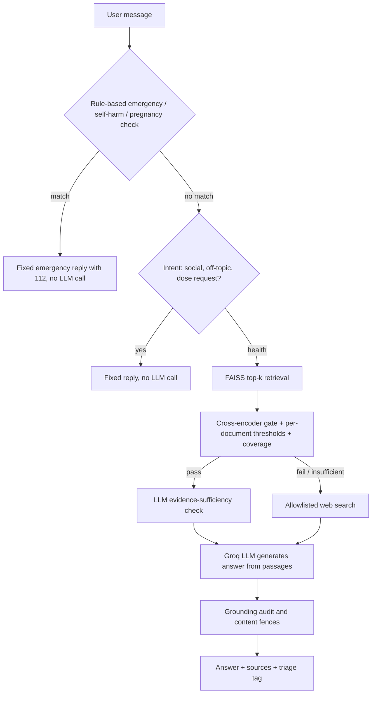

# SwasthyaSaathi

SwasthyaSaathi is a **public-health information chatbot** for India. A React chat interface talks to a FastAPI backend that answers health questions from a locally indexed set of WHO and Indian government health documents, shows the sources it used, escalates red-flag situations to India's emergency number **112**, and can fall back to web search restricted to an allowlist of health-authority sites.

> **It is an information tool, not a medical device.** It does not diagnose, prescribe or give doses, and it has **not been clinically validated or reviewed by clinicians**. Do not use it in an emergency; call **112** or go to the nearest emergency department.

- [Features](#features)
- [How it works](#how-it-works)
- [Repository layout](#repository-layout)
- [Local setup](#local-setup)
- [Environment variables](#environment-variables)
- [API reference](#api-reference)
- [Quality checks](#quality-checks)
- [Deployment](#deployment)
- [Knowledge base and source maintenance](#knowledge-base-and-source-maintenance)
- [Evaluation](#evaluation)
- [Safety and privacy](#safety-and-privacy)
- [Known limitations](#known-limitations)
- [Research paper](#research-paper)

## Features

Every item below was checked against the code in this repository.

| Feature | What it does | Where |
|---|---|---|
| Conversational chat | Warm, plain-language answers; greetings and small talk are answered without an LLM call. The system prompt asks for matching the user's language (including Hindi/Hinglish), but only English voice input is wired up and Hindi quality has not been evaluated. | `backend/app/rag/prompts.py`, `backend/app/rag/intent.py` |
| RAG with citations | FAISS semantic search over the local corpus, a cross-encoder relevance gate, an evidence-sufficiency check, then an LLM answer. The reply lists the sources used (document, section, snippet, URL for web sources). | `backend/app/agent/orchestrator.py`, `frontend/src/components/SourceCitations.jsx` |
| Emergency red-flag guidance | Rule-based checks run **before** any LLM call for chest pain with warning signs, trouble breathing, heavy bleeding, unconsciousness, stroke signs, overdose, fever in infants under 3 months, and pregnancy danger events. The reply tells the user to call 112 and shows a call button. | `deterministic_triage`, `is_immediate_emergency` in `orchestrator.py` / `intent.py` |
| Self-harm response | Explicit first-person self-harm or overdose statements get a fixed response with 112 and the Tele-MANAS helpline (default `14416`), with no LLM call. | `is_self_harm_crisis` in `orchestrator.py` |
| Medicine/dose fence | Requests for exact doses get a fixed refusal pointing to a clinician or pharmacist. A second-pass check removes numeric/medication claims not present in the supplied sources. | `_is_medication_advice_request`, `enforce_source_backed_fences` |
| Optional web search | When local passages do not cover a question (or the topic is in `uncovered_conditions.json`), a DuckDuckGo search restricted to allowlisted hosts (`WEB_ALLOWED_HOSTS`) is used. Redirects are not followed and results are re-checked against the allowlist. | `web_search_health_authority` |
| Health tools | **BMI calculator** (adults 20+; ages 2-19 are told percentile charts are needed), **Quick Help** (red-flag list, call-112 button, three canned questions, links to official pages), **Nearby Hospitals** panel. | `frontend/src/components/` |
| Nearby Hospitals | Three routes: open an entered place or PIN code in Google Maps; use the device's current location; or list up to 10 hospitals within 15 km inside the app via the backend (`POST /hospitals/nearby`). The in-app list requires `GEOAPIFY_API_KEY` on the server; without it the endpoint returns 503 and the UI still offers Maps. | `HospitalFinder.jsx`, `main.py` |
| Voice input | Browser speech recognition (`en-IN`) where supported. The browser may send audio to its own speech service. | `MessageInput.jsx` |
| Typing effect | Replies appear word by word, with a "Show full reply" button. | `MessageList.jsx` |
| Status and diagnostics | `GET /health` (index/embedding/integrity status), `GET /warmup`, and admin-token-protected `GET /latency` and `GET /admin/knowledge-gaps`. | `main.py` |

**Not implemented / stubs:** `get_regional_alerts` in the orchestrator is a placeholder that returns a fixed "no active alerts" payload labelled as a stub; there is no live outbreak feed. There are no user accounts, conversation history storage, or Telegram/WhatsApp/SMS channels.

## How it works



Answer modes returned by the API: `GROUNDED` (local sources), `WEB_TRUSTED` (allowlisted web pages), `MIXED`, `GENERAL` (no usable source; general educational guidance), and `SOCIAL`.

Main components:

- **Embeddings / index:** `sentence-transformers/all-MiniLM-L6-v2` via FastEmbed (ONNX, CPU), 384-dimensional, stored in a FAISS `IndexFlatIP`. The committed index holds **24,800 chunks from 32 source documents** (verified with `python verify_sources.py --check-index`).
- **Relevance gate:** `Xenova/ms-marco-MiniLM-L-6-v2` cross-encoder, a FAISS score floor (`GATE_FAISS_FLOOR`, 0.45), a hard cross-encoder floor of -9.5, and per-document thresholds in `data/vector_store/thresholds.json`. If the cross-encoder is unavailable the gate fails closed.
- **LLM:** Groq-hosted models. Default `GROQ_MODEL_NAME` is `qwen/qwen3.8-27b`, with fallback to `openai/gpt-oss-120b` then `openai/gpt-oss-20b` on rate-limit style errors (per-model cooldown circuit breaker). Educational "what is..." questions use `openai/gpt-oss-20b`. A chat request has a 25 s budget.
- **Caching:** educational answers are cached in memory (256 entries, 24 h). Startup warms the embedding model, FAISS and cross-encoder.
- **Frontend:** React 19, Vite, Tailwind CSS 3, axios, lucide-react.

## Repository layout

```
backend/
  app/
    main.py              FastAPI app and endpoints
    config.py            Settings read from environment / backend/.env
    schemas.py           Request/response models
    agent/               orchestrator (pipeline), warmup, latency + answer cache
    rag/                 retriever, gate, intent, ingest, integrity, prompts, gaps, ...
  data/
    raw_docs/            Source documents + SOURCES.md provenance registry (SHA-256)
    vector_store/        Committed FAISS index, chunk metadata, gate thresholds
    myths.json, uncovered_conditions.json
  eval/                  Gate-only benchmark (dataset generator, runner, results)
  frontend/              React + Vite app (vercel.json for Vercel)
  render.yaml            Render service definition
  requirements*.txt, verify_sources.py, test_*.py, run_eval_suite.py
Dockerfile               Backend image (port 7860)
docs/paper/              Research paper (LaTeX source and PDF)
```

The top-level `data/`, `data_pipeline/`, `calibrate_gate.py`, `get_chunks.py`, `step1_and_2_check.py`, `test_chikungunya_5x.py` and `eval_q3_q4_messages.json` look like earlier pipeline artifacts. The deployed backend (Dockerfile and `render.yaml`) uses only `backend/`.

## Local setup

**Requirements:** Python **3.11 or newer** (the code uses `enum.StrEnum`; the Dockerfile uses 3.11) and Node.js **20.19+ or 22.12+** (required by Vite 8). You also need a [Groq](https://console.groq.com/) API key for answer generation.

### Backend

Linux/macOS:

```bash
cd backend
python -m venv .venv && source .venv/bin/activate
pip install -r requirements.txt
cp .env.example .env            # then edit .env and set GROQ_API_KEY
python -m app.rag.ingest        # optional: rebuilds the index from data/raw_docs
uvicorn app.main:app --reload --port 8000
```

Windows PowerShell:

```powershell
cd backend
python -m venv .venv
.venv\Scripts\Activate.ps1
pip install -r requirements.txt
Copy-Item .env.example .env     # then edit .env and set GROQ_API_KEY
python -m app.rag.ingest
uvicorn app.main:app --reload --port 8000
```

A built index is already committed, so ingestion is only needed after you change files in `backend/data/raw_docs/`. Ingestion refuses documents not listed in `SOURCES.md` or whose SHA-256 prefix does not match, and writes `faiss_index.bin` / `chunk_metadata.json` plus compatibility copies `index.faiss` / `metadata.json`. The FastEmbed model is downloaded from Hugging Face on first use.

Check it is running: `curl http://localhost:8000/health` (interactive docs at `/docs`).

### Frontend

```bash
cd backend/frontend
npm install
VITE_API_BASE_URL=http://localhost:8000 npm run dev      # PowerShell: $env:VITE_API_BASE_URL = "http://localhost:8000"
```

Other scripts: `npm run build` (output in `dist/`), `npm run preview`, `npm run lint`.

> **Important:** `VITE_API_BASE_URL` is read **only in development** (`import.meta.env.DEV`). Production builds always call `https://swasthyasaathi-3.onrender.com` (hard-coded in `backend/frontend/src/api/client.js`). To point a production build at a different backend you must edit that file.

## Environment variables

Backend variables are read in `backend/app/config.py` (from `backend/.env` if present, otherwise the process environment). Placeholders only; never commit real secrets (`.env` is git-ignored).

| Variable | Default | Purpose |
|---|---|---|
| `GROQ_API_KEY` | empty | **Required** for LLM generation, triage, sufficiency and grounding checks. |
| `GEOAPIFY_API_KEY` | empty | Enables the in-app hospital list (`POST /hospitals/nearby`). Kept server-side; never sent to the browser. |
| `ALLOWED_ORIGINS` | `*` | Comma-separated CORS origins. Set to your frontend URL in production. |
| `GROQ_MODEL_NAME` | `qwen/qwen3.8-27b` | Primary generation model. |
| `EMBEDDING_MODEL_NAME` | `all-MiniLM-L6-v2` | Embedding model (must match the committed index). |
| `VECTOR_STORE_DIR` | `backend/data/vector_store` | FAISS index, metadata, thresholds. |
| `RAW_DOCS_DIR` | `backend/data/raw_docs` | Source documents and `SOURCES.md`. |
| `INTEGRITY_MODE` | `warn` | `strict` aborts startup if the index and source registry disagree (set by Dockerfile and `render.yaml`). |
| `GATE_FAISS_FLOOR` / `GATE_GLOBAL_THRESHOLD` / `GATE_MIN_CLUSTER_SAMPLES` | `0.45` / `-9.5` / `12` | Relevance-gate tuning. |
| `WEB_ALLOWED_HOSTS` | `who.int,mohfw.gov.in,icmr.gov.in,nhp.gov.in,nhm.gov.in,cdc.gov,nhs.uk,medlineplus.gov,nih.gov` | Hosts the web fallback may use. |
| `WEB_CACHE_TTL_SECONDS` | `3600` | Web-result cache lifetime. |
| `ENABLE_CONTENT_VERIFIER` | `true` | Second-pass LLM content check for general/mixed answers. |
| `EMERGENCY_NUMBER` / `MENTAL_HEALTH_HELPLINE` | `112` / `14416` | Numbers shown in crisis replies. |
| `HELPLINE_REFERRAL_TEXT` | generic referral sentence | Referral text setting. |
| `ADMIN_TOKEN` | empty | Enables `/latency` and `/admin/knowledge-gaps` (sent as `X-Admin-Token`). Endpoints return 503 when unset. |
| `GAPS_HASH_SALT` | `local-development-only-change-me` | Salt for hashing user identifiers in the gap/metadata tables. **Change in production.** |
| `GAPS_DB_PATH` | `backend/data/knowledge_gaps.sqlite3` | SQLite file for knowledge-gap and answer-decision aggregates. |
| `DATABASE_URL` | empty | Optional Postgres URL; if set, those aggregates go to Postgres instead of SQLite. |
| `UNCOVERED_CONDITIONS_FILE` | `backend/data/uncovered_conditions.json` | Conditions known to be missing from the corpus. |
| `ENABLE_CHIP_ANSWER_PREWARM` | unset | If `1`/`true`/`yes`, pre-computes six common answers at startup (read in `main.py`). |
| `PORT` | - | Used by Render's start command; the Dockerfile fixes port 7860. |
| `FASTEMBED_CACHE_PATH`, `HF_HOME` | - | Model cache locations (set in Dockerfile/`render.yaml`). |
| `VITE_API_BASE_URL` | `http://localhost:8000` | Frontend, **development only** (see above). |

## API reference

| Method and path | Auth | Description |
|---|---|---|
| `GET /` | none | Service banner. |
| `GET /health` | none | Vector count, embedding readiness, source/index integrity, status (`healthy`, `degraded`, `unindexed`). Used as Render's health check. |
| `GET /warmup` | none | Runs/reports the embedding + FAISS + cross-encoder warm-up. |
| `POST /chat` (aliases `/api/chat`, `/api/query`) | none | Chat. Body: `{"query": str (max 2000), "user_id": optional, "conversation_history": [{"role": "user"\|"assistant", "content": str}] (max 8 turns)}`. |
| `POST /hospitals/nearby` | none | Body: either `{"place": "..."}` or `{"latitude": .., "longitude": ..}`. Needs `GEOAPIFY_API_KEY`. |
| `GET /latency` | `X-Admin-Token` | p50/p95 and recent timing records only (no queries or answers). |
| `GET /admin/knowledge-gaps?limit=100` | `X-Admin-Token` | Aggregate topics the system could not answer from the corpus. |

There is no rate limiting or per-user authentication in the backend code.

```json
POST /chat
{ "query": "What are warning signs of severe dengue?", "conversation_history": [] }
```

The response contains `answer`, `sources`, `is_grounded`, `triage_tag` (`EMERGENCY`, `MATERNITY_URGENT`, `CONSULT_SOON`, `SELF_CARE`, `GENERAL_INFO`), `tools_used`, `response_time_ms`, `gate_decision`, `answer_mode`, `gate_scores`, `intent` and `emergency_contact`.

## Quality checks

Run from `backend/` unless noted:

```bash
python -m unittest discover -s . -p "test_quality*.py"   # 24 offline tests
python verify_sources.py                                  # source registry + SHA-256 check
python verify_sources.py --check-index                    # every registered doc is in the index
python -m compileall -q app
cd frontend && npm run lint && npm run build
```

On 2026-11-15 these all passed (24 tests; 32 registered documents; 24,800 vectors; lint and build clean). Other `test_*.py` files and `run_eval_suite.py` are live, networked scripts that need credentials and model downloads; they are not part of the fast check. There is no CI workflow in the repository.

## Deployment

The frontend and backend are deployed separately.

- **Frontend (Vercel):** `backend/frontend/vercel.json` (build `npm run build`, output `dist`, Vite framework, SPA rewrite to `index.html`). When creating the Vercel project, set the root directory to `backend/frontend`. The production build calls the hard-coded Render URL above.
- **Backend (Render):** `backend/render.yaml` defines a Python web service (`rootDir: backend`, region `singapore`, branch `main`, auto-deploy on commit, health check `/health`, start `uvicorn app.main:app --host 0.0.0.0 --port $PORT`). The build downloads the embedding and cross-encoder models and verifies the committed index instead of re-embedding. Set `GROQ_API_KEY`, `GEOAPIFY_API_KEY`, `ALLOWED_ORIGINS`, `ADMIN_TOKEN` and `GAPS_HASH_SALT` in the Render dashboard (they are `sync: false`).
- **Docker / Hugging Face Spaces:** the root `Dockerfile` (Python 3.11, port 7860, `INTEGRITY_MODE=strict`) pre-downloads the models, **re-runs ingestion at build time**, verifies the index and starts uvicorn. The YAML block at the top of this README (`sdk: docker`, `app_port: 7860`) is Hugging Face Spaces metadata.

The repository does not prove which of Render or a Hugging Face Space is currently live; the frontend only calls the Render URL. Verify in your hosting dashboards.

## Knowledge base and source maintenance

`backend/data/raw_docs/SOURCES.md` lists each document's publisher, URL, review date and SHA-256 prefix. The current corpus is 32 documents (24 PDFs and 8 text summaries): 24 attributed to WHO and the rest to MoHFW, ICMR, NHM or the Central TB Division (counts from `SOURCES.md`). Coverage is uneven; several diseases rely on one or two documents, and some `.txt` files are short summaries rather than full guidelines. To add or replace a document: place the file in `raw_docs/`, add its row to `SOURCES.md`, run `python -m app.rag.ingest`, then `python verify_sources.py --check-index`. `python verify_sources.py --check-urls` does a best-effort live URL check.

## Evaluation

`backend/eval/` contains a **gate-only** benchmark: 430 template-generated queries (300 calibration, 130 test) in four classes (in-KB, near-domain but uncovered, out-of-domain, small talk). Committed results (`eval/results.json`, `eval/RESULTS.md`) were produced with an alternate cached embedding adapter, **not** the production FastEmbed runtime, and were not re-run when this documentation was written. They measure only the retrieval/gate decision, not answer correctness, hallucination, safety recall or user outcomes. On the 130-query test split the final gate answered 0 of 45 near-domain uncovered queries (no false answers) but also refused 24 of 45 in-corpus queries, so it is conservative and falls back to web or general answers. No end-to-end answer-quality or emergency-detection benchmark exists in the repository.

## Safety and privacy

What the code does:

- Emergency, self-harm, pregnancy-danger and dose-request paths are deterministic and do not call the LLM. The emergency list is regex-based and English-centred; it is **not** a clinical triage system and can miss phrasing it does not match.
- LLM urgency labels can raise "consult soon" but cannot trigger the red emergency banner by themselves.
- Answers pass a lexical grounding check, an optional LLM audit and a numeric/medication fence. These reduce but do not eliminate unsupported statements.
- The API does not store conversations. The browser sends the current question and up to six recent turns with each request; they go to the Groq service. When web search is used, the query may go to the search provider and the fetched health sites. Voice input may be processed by the browser vendor. Opening Maps sends the place to Google; the in-app hospital list sends the place or coordinates to Geoapify via the backend.
- The backend does record **aggregates**: a SHA-256 hash of a PII-scrubbed, normalised topic (up to 180 characters is kept as text for refusal topics), an HMAC hash of the user id (the frontend always sends `"anonymous"`), answer mode, gate scores and timestamps, in SQLite or Postgres. Scrubbing is regex-based (emails, phone-like numbers, long digit strings) and will not catch all identifying text. Do not enter personal details.
- Server logs print timing and retrieval diagnostics, and some log lines include URLs fetched during web search.
- `ALLOWED_ORIGINS` defaults to `*`; restrict it in production.

## Known limitations

- No clinician review, clinical validation, usability study or real-user evaluation.
- Hindi/Hinglish handling is prompt-level and rule-level only (some Hinglish health keywords exist in the intent and gate rules); it has not been evaluated, and voice input is English only.
- Corpus coverage is uneven and static; guideline dates vary and a registry date is a review date, not a currency guarantee.
- Web fallback quality depends on DuckDuckGo results, page structure and the 25 s response budget.
- The free-tier style rate limits of the LLM provider can trigger model fallback or "busy" messages.
- `backend/QUALITY_STATUS.md` is a point-in-time note from 2026-11-04; see the update at its top.
- No LICENSE file is present in the repository; the licence is unspecified.

## Research paper

A paper describing the system, with only evidence-backed measurements and explicit limitations, is in [`docs/paper/`](docs/paper/): `swasthyasaathi_paper.tex` (source) and `swasthyasaathi_paper.pdf`. Build with `pdflatex` twice from that folder.
